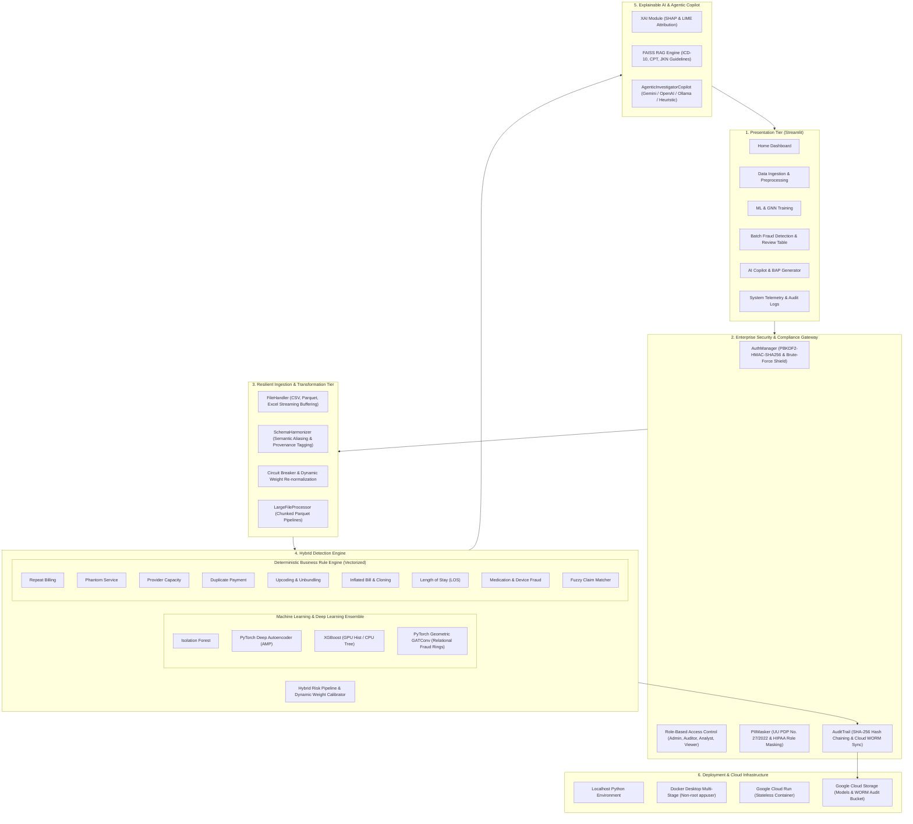

# ASTINA — System Architecture & Technical Design Document

Dokumen ini mendokumentasikan arsitektur sistem, aliran data, komponen rekayasa, dan topologi deployment untuk platform **ASTINA (AI-Powered Insurance Fraud & Anomaly Detection)**.

---

## 🏛️ 1. High-Level Architectural Overview

ASTINA dirancang dengan arsitektur berlapis (*layered architecture*) yang memisahkan presentasi interaktif, pemrosesan data bervolume tinggi, inferensi kecerdasan buatan (*hybrid ensemble*), dan pengamanan audit forensik.

---

## 🔒 2. Security & Regulatory Compliance Architecture

1. **Password Hashing KDF**:
   - Algoritma: `PBKDF2-HMAC-SHA256` dengan 100.000 iterasi dan random salt 16-byte kriptografis.
   - Dual-Mode Fallback: Kompatibel dengan legacy hash SHA-256 (`ASTINA_SECURE_SALT_v1`) dan melakukan migrasi in-place transparan saat login berhasil.
2. **Brute-Force & Lockout Shield**:
   - Ambang batas: 5 kali kesalahan login berturut-turut.
   - Cool-down: 15 menit akun terkunci.
   - Forensic Event: `USER_LOGIN_LOCKED` dicatat otomatis ke audit log.
3. **Role-Based Dynamic PII Masking (UU PDP No. 27/2022)**:
   - Kolom sensitif pasien (`NIK`, `Nama Pasien`, `No Peserta`) otomatis disamarkan untuk peran `Viewer` dan `Analyst`.
   - Peran `Auditor` dan `Admin` disediakan opsi resmi *Buka Masking Identitas Medis (Audit Mode)* yang mencatat event `PII_UNMASK` beserta daftar ID klaim yang diakses.
4. **Cryptographic WORM Audit Trail & Metric Sanitization**:
   - Integritas rantai blok SHA-256 (`prev_hash` -> `current_hash`).
   - Sanitasi deterministik metrik operasional (misalnya `processed_rows`, `processed_cols`) dengan validasi tipe numerik sebelum penulisan ke log audit untuk mencegah diskontinuitas rantai bukti forensik.
   - Trigger otomatis sinkronisasi ke Google Cloud Storage WORM Bucket tiap 50 event untuk perlindungan terhadap container ephemeral.
5. **Role-Based Rate Limiting & Resource Quota Hardening**:
   - Mencegah Resource Exhaustion & DoS: Pembatasan kuota unggahan harian, batas ukuran file per-role (hingga 3 GiB), serta kuota pelatihan dan inferensi per menit.
   - Type-Safe Parameter Handling: Penegakan tipe data eksplisit (`Optional[str]`, `Optional[int]`, dan casting integer limit) untuk menjamin evaluasi kuota bebas error baik untuk pengguna terautentikasi maupun anonim.

---

## ⚡ 3. Performance & Large Dataset Architecture

1. **Direct Disk Streaming Buffering & Typed Ingestion Engine**:
   - Upload file besar distreaming langsung ke Parquet bersegmen tanpa membengkakkan memori kerja (`RAM < 1GB`).
   - Streaming CSV didukung pemanggilan parser bertipe eksplisit (`chunksize`, `sep`, `encoding`, `on_bad_lines="warn"`) yang menghilangkan ambiguitas runtime overload.
   - Integrasi engine `Polars` dioptimasi sesuai spesifikasi API terbaru tanpa argumen deprecated untuk performa pembacaan data berkecepatan tinggi.
   - Excel upload diamankan dengan batas 100MB untuk mencegah memory spike openpyxl.
2. **Vectorized Business Rules**:
   - Evaluasi aturan bisnis dan relasi klaim dipercepat melalui indexing set vektor (`.isin()`) dan vektorisasi parsing waktu.
   - Early-exit pruning pada fuzzy matcher memangkas komputasi pasangan klaim yang tidak relevan secara finansial atau klinis.
3. **Dual Execution Mode**:
   - *Mode Eksplorasi Cepat*: Sampling interaktif 10.000 baris untuk visualisasi instan di UI Streamlit.
   - *Mode Batch Forensik*: Pipeline streaming Parquet menyeluruh untuk audit puluhan ribu hingga jutaan baris tanpa membebani browser.

---

## ☁️ 4. Deployment Topologies

- **Docker Desktop**: Kontainer multi-stage Python 3.12-slim yang berjalan dengan user non-root UID 1000 (`appuser`), healthcheck `/_stcore/health`, resource memory limit 8GB, 4 CPUs, dan upload support hingga 3GB.
- **Google Cloud Run**: Serverless container stateless dengan persistent artifact sync ke Google Cloud Storage (`GOOGLE_CLOUD_BUCKET`), integrasi Secret Manager untuk kredensial produksi, dan batasan payload 30MB yang aman.

---

## 🔬 5. Code Quality, Type Safety & Automated Verification

- **Static Type Safety Guarantee**: Pematuhan ketat terhadap type stubs Python/Pyright pada modul kritis (`file_handler.py`, `rate_limit.py`, `ui/pages/data_collection.py`), mencegah kegagalan runtime akibat inkonsistensi tipe data atau unpacking dictionary tanpa tipe tetap.
- **Zero-Regression Test Suite**: Diverifikasi penuh melalui pengujian otomatis dengan 100% pass rate:
  - `tests/test_cybersecurity_and_auth.py` (Autentikasi KDF, Brute Force, Rate Limiting & PII Masking).
  - `tests/test_large_file_ingestion.py` (Streaming CSV/Excel/Parquet, Deduping & Disk Ingestion).
  - `tests/test_streaming_preprocessing_memory.py` & `test_train_only_preprocessing.py` (Transformasi streaming terikat memori & isolasi partisi train).
