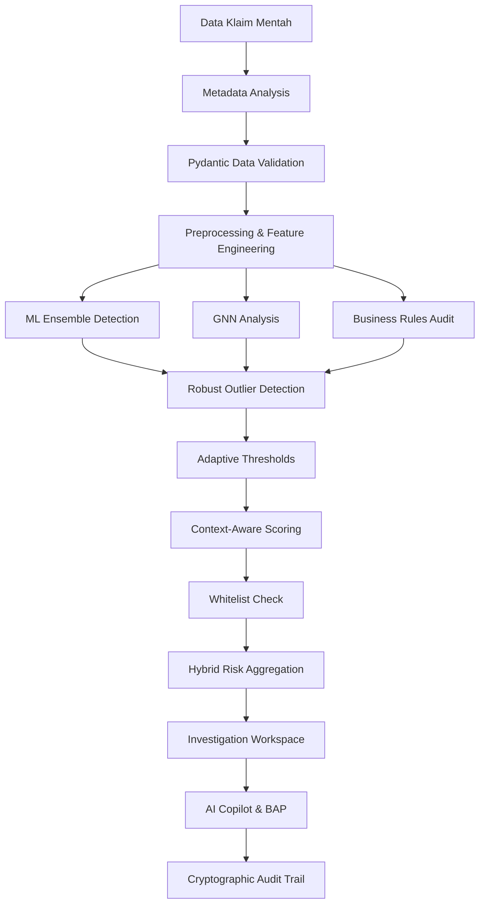

# ASTINA — AI-Powered Insurance Fraud & Anomaly Detection

**ASTINA** adalah platform analitik dan investigasi fraud klaim asuransi kesehatan berbasis **Hybrid AI Enterprise** yang menggabungkan kekuatan **Machine Learning Ensemble** (Isolation Forest, Autoencoder, XGBoost, GNN) dengan **Rule-Based Business Engine** (9 modul aturan audit klaim), **Agentic AI Copilot bertenaga RAG**, serta **Audit Trail Kriptografis**.

**🎯 Fitur Unggulan:** ~80% reduksi false positive dengan Adaptive Thresholds, Context-Aware Scoring, dan Historical Learning

---

## 🚀 Fitur Utama

### 🔍 Hybrid Detection Engine
- **ML Ensemble**: Isolation Forest, Autoencoder, XGBoost, dan Graph Neural Network (GNN)
- **Business Rules Engine**: 9 modul aturan audit klaim asuransi (Repeat Billing, Phantom Service, Provider Capacity, dll)
- **Hybrid Scoring**: Kombinasi probabilitas anomali statistik dengan validasi deterministik aturan bisnis
- **Optuna Optimization**: Optimasi hyperparameter dan bobot ensemble otomatis

### 🔄 Smart Data Processing
- **Semantic Schema Harmonizer**: Penyelarasan otomatis sinonim kolom bahasa Indonesia ke kolom kanonikal
- **Metadata Analysis System**: Analisis otomatis kecukupan fitur dataset dengan gap analysis dan rekomendasi
- **Pydantic Data Validation**: Type-safe validation dengan automatic validators
- **Multi-Format Ingestion**: Dukungan CSV, Excel (.xlsx, .xls), dan Parquet dengan streaming chunk processing
- **Key-Based Dataset Merge**: Penggabungan multi-dataset berdasarkan kesamaan kolom (inner, left, outer, cross join)
- **Intelligent Feature Selection**: SelectKBest, Tree-based Importance, Multicollinearity Filter, PCA
- **Leakage-Safe Splitting**: Train/validation/test split sebelum preprocessing

### 🤖 AI Copilot & RAG
- **Multi-Provider LLM**: Google Gemini (2.x, 2.5.x, 3.x), OpenAI, Local Ollama, Offline Heuristic Engine
- **RAG Knowledge Base**: FAISS vector search dengan regulasi medis (ICD-10, CPT, JKN)
- **Auto BAP Generation**: Pembuatan Berita Acara Pemeriksaan (BAP) formal secara otomatis
- **Model Interpretation**: Laporan naratif training model dengan AI generatif dan PDF export lengkap
- **PDF Report dengan Grafik & Tabel**: Laporan PDF berisi semua grafik (pie chart, GNN visualization) dan tabel (metrik model, hasil optimasi) dari pelatihan
- **PII Masking**: Proteksi data sensitif sesuai UU PDP dan HIPAA

### 🔐 Enterprise Security
- **RBAC Authentication**: 4 role (Admin, Auditor, Analyst, Viewer) dengan PBKDF2-HMAC-SHA256 hashing
- **PII Masking**: Proteksi data sensitif sesuai UU PDP No. 27/2022 dan HIPAA
- **Cryptographic Audit Trail**: Berantai hash SHA-256 anti-tamper untuk forensik
- **OWASP Hardening**: Redaksi stack trace teknis di mode produksi
- **Prompt Injection Guardrail**: Proteksi terhadap jailbreak dan prompt injection

### 📊 Investigation Workspace
- **6-Tab Detection Interface**: Ringkasan & Visualisasi, Business Risk & Rules, Fraud Review Table, AI Copilot & BAP, Concept Drift & Retraining, Advanced Detection Settings
- **Explainable AI**: SHAP & LIME untuk transparansi model
- **Real-Time Telemetry**: Monitoring CPU, RAM, GPU/VRAM, dan latensi inferensi
- **Multi-Format Export**: CSV, Excel, JSON untuk audit trail

### 🎯 False Alarm Reduction (Phase 1 & 2)
- **Robust Outlier Detection**: MAD, IQR, Modified Z-Score
- **Adaptive Thresholds**: Threshold dinamis berdasarkan historical patterns
- **Context-Aware Scoring**: Composite risk scoring dengan patient history, provider reputation
- **Whitelist System**: 10 kondisi kronis dengan frekuensi wajar
- **Historical Learning**: Continuous learning dengan concept drift detection
- **Intelligent Flag Suppression**: Suppress flags berdasarkan context intelligence

### ⚙️ Production Ready
- **Multi-Environment**: Localhost, Docker Desktop, Google Cloud Run
- **CI/CD Pipeline**: GitHub Actions otomatis
- **Automated Testing**: 239+ unit & integration tests (100% pass rate)
- **GPU Acceleration**: CUDA 12.4 support untuk NVIDIA GeForce RTX 3050+ (opsional)

---

## 📁 Struktur Repositori Utama

```
project-Graphnet/
├── main.py                          # Entry point aplikasi Streamlit
├── run.py                           # Launcher aplikasi
├── config.py                        # Konfigurasi global
├── model.py                         # Arsitektur ML Ensemble
├── agentic_copilot.py               # AI Copilot investigasi
├── pdf_generator.py                 # Generator laporan PDF
├── requirements.txt                 # Dependensi Python
├── ui/                              # Antarmuka Streamlit
│   ├── sidebar.py                   # Navigasi & status
│   └── pages/                       # Halaman aplikasi
│       ├── home.py                  # Dashboard
│       ├── data_collection.py       # Upload & preprocessing
│       ├── training.py              # Pelatihan model
│       ├── evaluation.py            # Evaluasi performa
│       ├── detection.py             # Deteksi fraud
│       ├── status.py                # Status sistem
│       └── settings.py              # Pengaturan
├── tests/                           # Unit & integration tests
├── cache/                           # Cache directory (auto-created)
├── models/                          # Model artifacts (auto-created)
├── logs/                            # Log files (auto-created)
└── Dockerfile                       # Docker image
```

---

## ⚙️ Persyaratan Sistem

- **Python**: 3.11 - 3.13 (Direkomendasikan 3.13)
- **Hardware**: 4 Core CPU, 8 GB RAM (16 GB untuk dataset besar & GNN)
- **GPU Opsional**: NVIDIA CUDA 12.x untuk akselerasi PyTorch/GNN
- **Docker**: Docker Desktop dengan Docker Compose v2 (opsional)

---

## 🛠️ Cara Instalasi

### Opsi 1: Local Environment (Recommended)

```bash
# Masuk ke direktori proyek
cd C:\project-Graphnet

# Buat virtual environment
python -m venv .venv
.venv\Scripts\Activate.ps1  # Windows
# source .venv/bin/activate  # Linux/macOS

# Install dependensi
pip install -r requirements.txt

# Jalankan aplikasi
python run.py
```

### Opsi 2: Mode GPU CUDA (Opsional)

```bash
# Install PyTorch dengan CUDA 12.4
pip install torch==2.6.0 torchvision torchaudio --index-url https://download.pytorch.org/whl/cu124
pip install torch-geometric==2.6.0
pip install -r requirements.txt

# Verifikasi GPU
python -c "import torch; print('CUDA Available:', torch.cuda.is_available())"
```

### Opsi 3: Docker Desktop

```bash
# Buat folder yang diperlukan
mkdir cache models logs

# Jalankan dengan Docker Compose
docker compose up --build -d

# Akses di http://localhost:8501
```

---

## 🔐 Autentikasi & RBAC

### Mode Pengoperasian

| Mode | Konfigurasi | Deskripsi |
|------|-------------|-----------|
| Development | `AUTH_ENABLED=false` | Login bypassed, role Admin otomatis |
| Production | `AUTH_ENABLED=true` | Login wajib, RBAC aktif |

### Akun Bawaan

| Role | Username | Password Default | Akses |
|------|----------|------------------|-------|
| Admin | `admin` | `AdminAstina2026!` | Semua halaman |
| Auditor | `auditor` | `AuditorAstina2026!` | Deteksi, Status, Settings |
| Analyst | `analyst` | `AnalystAstina2026!` | Upload, Training, Evaluasi, Deteksi |
| Viewer | `viewer` | `ViewerAstina2026!` | Home, Status (read-only) |

### Mengubah Password Default

```powershell
# Windows PowerShell
$env:ASTINA_ADMIN_PASSWORD="KataSandiBaru!"
python run.py
```

```bash
# Linux/macOS
export ASTINA_ADMIN_PASSWORD="KataSandiBaru!"
python run.py
```

---

## 📋 Format Data

### Dataset Sampel

Folder `docs/` berisi dataset sampel yang siap digunakan untuk testing:
- **📁 `docs/sample_claims.csv`**: 50 klaim sampel dalam format yang sesuai skema ASTINA

### Kolom Inti yang Diperlukan

| Kolom | Tipe | Deskripsi |
|-------|------|-----------|
| `claim_id` | String/Int | ID unik klaim |
| `patient_id` | String/Int | ID unik pasien |
| `provider_id` | String/Int | Kode faskes/dokter |
| `service_code` | String | Kode prosedur medis |
| `diagnosis_code` | String | Kode ICD-10 |
| `billing_date` | Date | Tanggal penagihan |
| `service_date` | Date | Tanggal tindakan |
| `billed_amount` | Float | Nominal tagihan |
| `paid_amount` | Float | Nominal dibayar |
| `claim_status` | String | Status klaim |
| `patient_age` | Integer | Usia pasien |
| `length_of_stay` | Integer | Lama rawat (hari) |
| `quantity` | Integer | Kuantitas obat/alkes |

### Semantic Schema Harmonizer

Sistem otomatis menyelaraskan sinonim kolom bahasa Indonesia:
- `no_klaim` → `claim_id`
- `no_peserta` → `patient_id`
- `kode_faskes` → `provider_id`
- `biaya_tagihan` → `billed_amount`
- `lama_rawat` → `length_of_stay`

---

## 🧠 Alur Kerja



### Langkah Penggunaan

1. **Upload Data**: Unggah dataset di halaman "Unggah Data Transaksi"
2. **Preprocessing**: Sistem otomatis analisis metadata dan preprocessing
3. **Training**: Latih model ensemble dengan konfigurasi yang diinginkan
4. **Evaluation**: Evaluasi performa model dengan metrik lengkap
5. **Detection**: Deteksi fraud pada dataset baru dengan hybrid scoring
6. **Investigation**: Gunakan AI Copilot untuk generate BAP dan analisis mendalam

---

## 🤖 Konfigurasi LLM

### Model Gemini Tersedia

**Generasi Terbaru (Recommended):**
- `gemini-2.0-flash-exp` (default - generasi 2, cepat & hemat)
- `gemini-2.0-flash-lite-exp` (lebih ringan & hemat kuota)
- `gemini-2.5-flash-exp` (generasi 2.5, performa tinggi)
- `gemini-2.5-flash-lite-exp` (ringan, hemat kuota)
- `gemini-2.5-flash-tts-exp` (dengan dukungan TTS)
- `gemini-2.5-pro-exp` (generasi 2.5 pro, sangat akurat)
- `gemini-2.5-pro-tts-exp` (pro dengan dukungan TTS)
- `gemini-3.0-flash-exp` (generasi 3 terbaru)

**Generasi Sebelumnya:**
- `gemini-1.5-flash` (stabil, cepat & hemat)
- `gemini-1.5-flash-8b` (versi ringan)
- `gemini-1.5-pro` (lebih akurat)

### Menggunakan LLM

1. Buka halaman **Settings** → tab **🔌 LLM & Copilot**
2. Pilih provider (Gemini/OpenAI/Ollama/Heuristic)
3. Masukkan API Key (untuk Gemini/OpenAI)
4. Pilih model dari dropdown
5. Klik **🔌 Test Koneksi** untuk verifikasi

**Environment Variables:**
```bash
export LLM_PROVIDER="gemini"
export LLM_MODEL_NAME="gemini-2.0-flash-exp"
export GEMINI_API_KEY="your-api-key"
```

---

## � Laporan PDF Pelatihan Model

### Fitur Laporan PDF

ASTINA menyediakan fitur laporan PDF komprehensif yang berisi:
- **Ringkasan Eksekutif**: Gambaran singkat hasil pelatihan model
- **Analisis Dataset**: Informasi ukuran dataset, preprocessing, dan fitur
- **Analisis Fitur**: Detail seleksi fitur dan metode yang digunakan
- **Arsitektur Model**: Konfigurasi ensemble dan algoritma yang dilatih
- **Proses Pelatihan**: Konfigurasi hyperparameter dan alur pelatihan
- **Metrik Performa**: Status model dan distribusi bobot ensemble
- **Rekomendasi**: Saran untuk pengembangan model selanjutnya
- **Grafik Visual**:
  - 📊 Pie chart distribusi bobot ensemble
  - 🕸️ Visualisasi jaringan anomali GNN (jika GNN dilatih)
- **Tabel Data**:
  - 📋 Tabel metrik model lengkap (status, bobot, detail)
  - 📈 Tabel hasil optimasi Optuna (jika digunakan)

### Cara Menggunakan Laporan PDF

1. **Selesaikan Pelatihan Model**
   - Buka halaman **Pelatihan Model**
   - Upload dan preprocessing data
   - Konfigurasi dan jalankan training

2. **Generate Laporan Interpretasi**
   - Setelah training selesai, klik **"🚀 Generate Laporan Interpretasi"**
   - Pilih provider AI (heuristic/gemini/openai/ollama)
   - Sistem akan otomatis menangkap semua grafik dan tabel

3. **Unduh PDF**
   - Klik **"📄 Unduh Laporan Interpretasi (PDF)"**
   - PDF akan diunduh dengan nama: `ASTINA_Model_Training_Report_YYYYMMDD_HHMMSS.pdf`

### Konten Laporan PDF

Laporan PDF secara otomatis menyertakan:

**📊 Grafik yang Disertakan:**
- **Distribusi Bobot Ensemble**: Pie chart menampilkan persentase kontribusi setiap algoritma (Isolation Forest, Autoencoder, GNN, XGBoost)
- **Visualisasi Jaringan Anomali GNN**: Network graph menampilkan node anomali (seed) dan tetangga 1-hopnya dengan skor GNN

**📋 Tabel yang Disertakan:**
- **Tabel Metrik Model**: Status pelatihan, bobot ensemble, dan detail konfigurasi untuk setiap algoritma
- **Tabel Hasil Optimasi Optuna**: Perbandingan metrik sebelum dan sesudah optimasi (FPR, Precision, Recall, F1-Score)

**📝 Bagian Naratif:**
- Ringkasan eksekutif dengan analisis AI generatif (jika provider AI aktif)
- Analisis dataset dan preprocessing
- Analisis fitur dan seleksi
- Arsitektur model ensemble
- Proses pelatihan dan hyperparameter
- Metrik performa dan hasil optimasi
- Rekomendasi untuk pengembangan selanjutnya

### Provider AI untuk Laporan

| Provider | Deskripsi | Kelebihan |
|----------|-----------|-----------|
| **heuristic** | Mode offline tanpa API key | Cepat, tidak perlu koneksi internet |
| **gemini** | Google Gemini 2.x, 2.5.x, 3.x | Laporan naratif yang lebih kaya dan akurat |
| **openai** | OpenAI GPT models | Integrasi dengan ekosistem OpenAI |
| **ollama** | Local LLM (Llama, Mistral, dll) | Privacy dan kontrol penuh data |

---

## �🔧 Troubleshooting

### Error: "PyTorch tidak tersedia"
```bash
# Install PyTorch dengan CPU support
pip install torch==2.6.0 torchvision torchaudio --index-url https://download.pytorch.org/whl/cpu
pip install torch-geometric==2.6.0
```

### Error: "API Key kosong"
- Pastikan API key sudah dimasukkan di Settings
- Atau set environment variable yang sesuai

### Error: "Memory exhausted"
- Gunakan dataset yang lebih kecil
- Gunakan format Parquet (lebih hemat memori)
- Tingkatkan RAM sistem atau gunakan GPU

### Error: "Training thread race condition"
- Tunggu training selesai sebelum memulai training baru
- Refresh halaman jika terjadi error

---

## 📊 Changelog

### Versi Terbaru (2026-10-25)

**Perbaikan QA:**
- ✅ Fixed training thread race condition
- ✅ Fixed unbound variables error
- ✅ Fixed configuration inconsistency
- ✅ Improved error handling with stack trace
- ✅ Added Gemini 2.x, 2.5.x, 3.x model support
- ✅ Improved LLM connection test with detailed troubleshooting
- ✅ Fixed PDF generation with charts and tables
- ✅ Fixed reportlab style conflicts and alignment issues

**Fitur Baru:**
- 📄 Laporan PDF lengkap dengan grafik dan tabel dari pelatihan model
- 📊 Grafik distribusi bobot ensemble dalam PDF (pie chart)
- 🕸️ Visualisasi jaringan anomali GNN dalam PDF
- 📋 Tabel metrik model lengkap dalam PDF
- 📈 Tabel hasil optimasi Optuna dalam PDF
- 🤖 Model Gemini 2, 2.5, dan 3 tersedia
- 🔧 Improved configuration validation

---

## 📞 Support

Untuk pertanyaan atau bantuan:
- **Documentation**: Lihat folder `docs/` untuk panduan detail
- **Issues**: Laporkan bug di GitHub Issues
- **Testing**: Dataset sampel tersedia di `docs/sample_claims.csv`

---

## 📄 License

[License Information]

---

**Last Updated**: 2026-10-25
**Version**: 2.1.0
**Status**: Production Ready ✅
